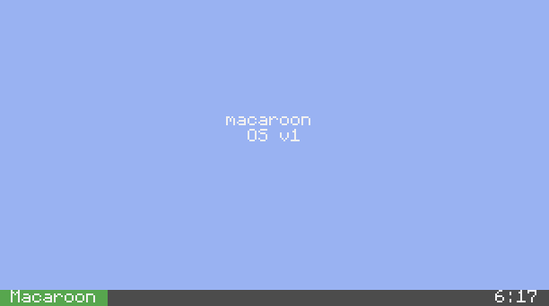

# Macaroon OS

A desktop for your ComputerCraft computer.



Macaroon OS turns an Advanced Computer into a small Windows-style desktop:
draggable windows, a Start menu, user accounts, and apps like Files, Terminal,
and Notepad. Install it with one command; it updates itself from then on.


## What you get

- A desktop with draggable, focusable windows and a taskbar clock
- A Start menu with Files, Terminal, Notepad, Settings, Users, Store, and Update
- User accounts with a login screen
- A self-updater — no reinstalling for every release
- A crash screen that tells you what went wrong and reboots
- A recovery option that keeps your accounts

## What you need

- An **Advanced Computer** (colour and mouse support)
- **ComputerCraft: Tweaked** with the HTTP API enabled
- Internet access on the computer for install and updates

## Install

On the ComputerCraft computer, run:

```
wget run https://raw.githubusercontent.com/Codingishardlol/MacaroonOS/main/installer.lua
```

The installer downloads the OS, backs up your existing `startup.lua` to
`startup.bak`, asks you to create an admin account, then reboots.

That's it. Macaroon OS starts automatically on every boot from then on.

> Prefer pastebin? Upload `installer.lua` there and use `pastebin run <code>`.

## First boot

If you created an account during install, you'll see the login screen:

1. Click your user tile (or use ↑/↓).
2. Type your password.
3. Press Enter.

If the computer has no accounts, it boots straight to the desktop.

`Ctrl+T` is disabled at every screen. To use a shell, open the **Terminal** app
after logging in.

## Using it

| Action | How |
| --- | --- |
| Open the Start menu | `F1` or click **Start** |
| Focus a window | Click it |
| Move a window | Drag its title bar |
| Close a window | Click `X` or press `Delete` |
| Open a shell | Start → **Terminal** |
| Lock the computer | Start → **Lock** |

### Apps

| App | What it does |
| --- | --- |
| Files | Browse, view, copy, rename, create, and delete files |
| Terminal | Run shell commands in a window |
| Notepad | Edit, open, and save your own text files |
| Settings | Change wallpaper, clock format, updates, and channel |
| Users | Add or remove users and change passwords |
| Store | Download individual apps from the project manifest |
| Update | Check for and install OS updates |
| Hello / About | Small sample apps |

Notepad shortcuts: `F2` save, `F3` open, `F4` new, `F5` save as. Notepad will
not open or overwrite the OS's own files.

## Updating

You can update in three ways:

1. **On reboot** — answer `y` when the update prompt appears.
2. **Update app** — Start → Update → `[ Check ]` → `[ Install ]`.
3. **Terminal** — run `update`.

Updates replace code only. Your accounts, settings, and update source stay
untouched. If you're offline, the update is skipped and boot continues.

### Stable or beta

The **stable** channel follows `main`; **beta** follows the beta branch. You can
switch from the installer, the Update app, or Settings. Most people should stay
on stable.

## Accounts and login

- Add or remove users in the **Users** app. The last remaining account cannot be
  removed.
- Passwords are stored as salted hashes, never as plaintext.
- Five wrong attempts shut the computer down. Repeated failures across reboots
  add a 30-second wait.
- Hold `R` during the splash to reinstall the OS while keeping your accounts.
  Recovery does not give you a shell.

Like any ComputerCraft OS, this protects against someone at the keyboard. It
can't protect against someone who can open the world save or the CraftOS-PC
data folder and delete the login gate.

## Uninstall

Open the **Terminal** app and run:

```
rm startup.lua
rm macaroon
```

Then reboot. You'll be back in plain CraftOS. Your pre-install `startup.lua`
backup is in `startup.bak`.

This removes your Macaroon OS accounts and settings too. Back them up first if
you might want them later.

## Troubleshooting

**The install command does nothing.**
Check that you're on an Advanced Computer and that the HTTP API is enabled in
ComputerCraft. If `wget` still fails, upload `installer.lua` to pastebin and use
`pastebin run <code>`.

**It boots to an error screen.**
The crash screen shows the error and reboots. If it keeps happening, reinstall
with the command above; your accounts are kept.

**An update doesn't appear.**
Updates need HTTP access. If you're offline, the check is skipped. Try
Start → Update → `[ Check ]` when you're back online.

**I forgot my password.**
There is no password reset from the login screen, and recovery keeps your
accounts. If you have a backup of `macaroon/users.dat`, restore it with file
access; otherwise the machine needs to be reset from outside the OS.

**How do I get back to CraftOS?**
See **Uninstall** above.

## For developers

Source layout, the app contract, Lua 5.1 rules, and the release checklist are
in the project docs:

- `AGENTS.md` — workflow, commands, git rules
- `SPEC.md` — as-built behaviour
- `THREAT_MODEL.md` — security model
- `macaroon/AGENTS.md` — code and app rules
- `tests/AGENTS.md` — test suite
- `MILESTONES.md` — milestone history
- `STATE.md` — current version and branch
